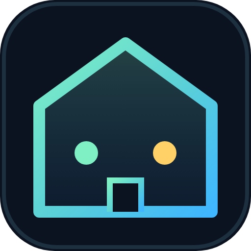
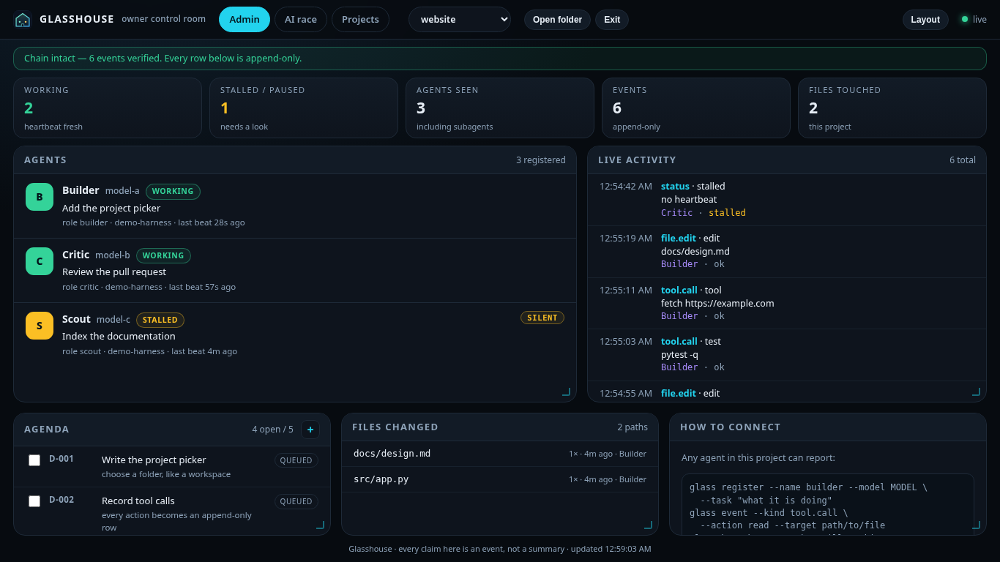
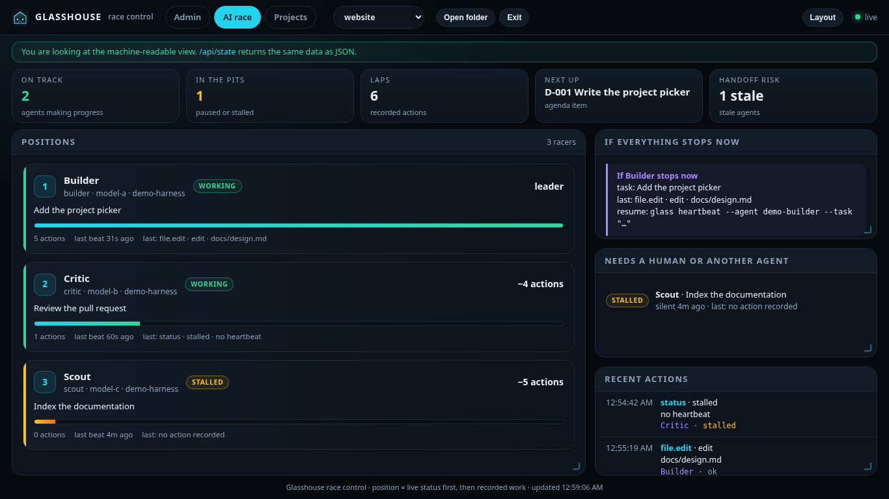
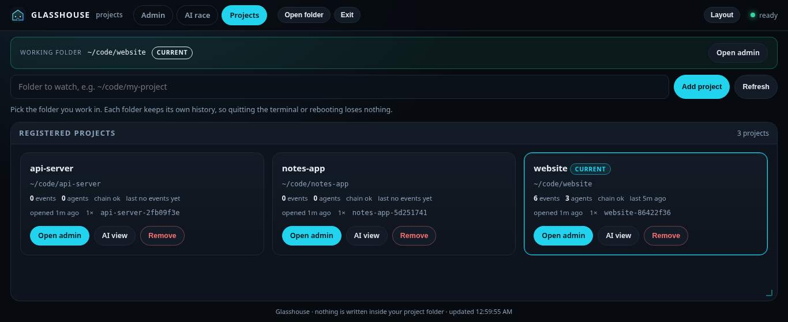

<p align="center">
  
</p>

<h1 align="center">Glasshouse</h1>

<p align="center">
  <b>A local control room for AI agents — see what they are doing, on which project, right now.</b>
</p>

<p align="center">
  Agents write events; Glasshouse keeps them in an append-only, hash-chained log and shows them in
  two views. No cloud, no account, no telemetry, no dependencies beyond Python's standard library.
</p>

- **`/` admin view** — every agent, model, task, tool call, file edit, heartbeat, pause and stall.
- **`/ai` race view** — a compact, agent-readable "who is where and what is next" board.
- **`/projects`** — pick a folder, like opening a workspace in an editor.

> In the examples below, `glass` means the `glasshouse` command (or `./bin/glass` when running from a
> clone).

## The ecosystem in one picture

```
   agent (any harness)                 glass / HTTP
   ──────────────────                 ─────────────
   register ──┐
   event    ──┼──►  one SQLite file per project  ──►  HTTP + SSE  ──►  /        admin view
   heartbeat ─┘      append-only, hash-chained          │             /ai      race view
                                                         │             /projects picker
                                                         └──────────►  /api/*   any program
```

Five pieces, no server farm:

1. **Identity** — an agent gets an id (or brings one). It also reports its folder.
2. **Events** — every action becomes a row: what happened, to what, with what result.
3. **The chain** — each row commits to the previous row's hash, so edits are detectable.
4. **The project** — rows are grouped by folder, not by agent, so histories never mix.
5. **The views** — HTML for humans, JSON for agents, SSE for live updates.

The dashboard is a *reader*. Nothing depends on it being open; agents keep writing while it is
closed, and the history is there when it comes back.

Each project folder gets its own history. Quitting the terminal, closing the browser, or rebooting
loses nothing: the history lives in `~/.local/share/glasshouse`, never inside your repository.



<details>
<summary>More screenshots: agent race view and project picker</summary>





</details>

---

## Reading the dashboard

Three screens, one store.

**`/` admin** — the numbers (who is working, what is stalled, how many events), the agents, the live
activity feed, the agenda, and which files changed. **`/ai` race** — the same facts arranged as a race:
who is leading, who is in the pits, what happens if everyone stops right now. **`/projects`** — the
folder picker.

### Make it your own

The **Layout** button (top right) turns the board into something you arrange:

- **Move & resize…** draws a resize handle in every block's corner and makes each block's title draggable.
  Drag the corner to change how many columns and rows a block takes. Drag a title onto another block to
  move it there.
- Width is a **trade**: widening a block takes columns from the block next to it in the same row, so a row
  always still adds up. Making a block taller pushes the row below it down.
- Presets: **Default (2 up, 3 down)**, **One column**, **One row**, **Two per row**, and **Reset**.
- The arrangement is remembered per page, in this browser. Nothing is sent anywhere.

Two rules make it usable rather than a wall of text:

- **The page never scrolls; blocks do.** Every block has a fixed share of the screen and its own
  scrollbar, so the header, the numbers and the neighbouring blocks stay where they are while you read a
  long feed. The block under your mouse is the only thing that moves.
- **Two clicks to add work.** The agenda has a **`+`** in its header (next to `2 open / 3`). Click it,
  type, press Enter. The item is written to that project's `TODO.md`, so the file stays the source of
  truth and a tick in the dashboard survives a restart.

The top bar is the other half of it. **Open folder** browses your disk and starts watching whatever you
pick — no path typing, no editing a config file. **Exit** leaves the project (`?project=@none`), so the last
folder you happened to open never becomes a trap. Nothing here is tied to a particular editor or agent: if
it has a shell, it can report to the same server.

The projects page answers two questions honestly: *which folder am I looking at* (the working-folder bar
at the top, with a `CURRENT` badge) and *is it actually recording* (each card shows events, agents, chain
state and the age of the last event). Adding a folder either says `Added "name"` or tells you exactly
why it refused — a relative path, a file instead of a folder, or a folder that does not exist.

---

## Why it exists

An agent that says "done" is making a claim. An event is a record. Glasshouse is the record:

- **append-only** — events are never edited or deleted by the tool;
- **hash-chained** — each event commits to the previous one, so an accidental edit or a naive
  rewrite is detectable (`glass verify`);
- **project-scoped** — one dashboard, many folders, no mixing of histories;
- **local-only** — binds to `127.0.0.1`, shows prompts and paths, and is not safe to expose.

It is a transparency tool, **not a sandbox** and not a security boundary. Read
[Limits](#limits) before trusting it.

---

## Install

Glasshouse needs **Python 3.10+** and nothing else. Pick one:

### 1. Run from a clone (simplest, nothing installed)

```bash
git clone https://github.com/0mpardeshi/glasshouse.git
cd glasshouse
./install.sh
```

`install.sh` adds a desktop launcher, an icon, and a login autostart, then starts the dashboard.
It works without `pip`, `npm`, or root.

You get a **double-clickable Glasshouse icon on your desktop** (if you have a desktop folder), the
same entry in your applications menu, and the dashboard already running.

### 2. pipx (isolated command on your PATH)

```bash
pipx install .
glasshouse setup --start
```

### 3. Plain pip

```bash
python3 -m pip install --user .
glasshouse setup --start
```

Either way you get:

- a **Glasshouse** icon on your desktop and in your applications menu,
- a **project picker** instead of a terminal command,
- a server that starts at login and keeps the history.

**Cannot find the icon?** On a maximised window the desktop is hidden — click the *show desktop*
button, or open your applications menu and look under **Development**. If you use a taskbar
quick-launch area (LXQt, Xfce), drag the desktop icon into it and it stays visible.

To skip the desktop icon, set `GLASSHOUSE_NO_DESKTOP=1` before installing. To undo the desktop
integration:

```bash
glasshouse setup --remove
```

If you added the icon to a taskbar yourself, remove that entry too.

---

## First five minutes

```bash
# Register the folder you are working in
glass add ~/code/my-project

# Open it: starts the server if needed and opens the browser
glass open ~/code/my-project

# Or open the picker (what the desktop icon runs)
glass menu

# Is everything actually working? This checks server, admin view, AI view, database and chain.
glass doctor
```

Useful commands:

| Command | What it does |
|---|---|
| `glass projects` | List registered folders, most recent first |
| `glass open [FOLDER]` | Register + start + open the dashboard |
| `glass menu` | Open the project picker |
| `glass doctor [--start]` | Self-check every layer, including the HTML views |
| `glass status` | The same state in the terminal |
| `glass verify` | Recompute the event hash chain |
| `glass setup [--start] [--remove]` | Desktop launcher, icon, login autostart |
| `glass remove <id> [--delete]` | Unregister a project (optionally delete its history) |
| `glass export --out DIR` | Build a privacy-checked copy for publishing |

Everything accepts `--json` where it makes sense, so another program can read it.

---

## Connecting an agent

Any process that can run a command can report. Three calls are enough:

```bash
glass register --name builder --model "your-model" --task "what it is doing"
glass event --kind tool.call --action read --target src/main.py --status ok
glass heartbeat --task "still working"
```

Event kinds: `agent.join`, `tool.call`, `file.edit`, `test`, `status`, `git.commit`, `note`.

Rules that keep the record honest:

- call `register` once per agent (a subagent is its own agent);
- call `heartbeat` while working, so a crashed agent shows as **stalled** instead of **working**;
- call `glass event` after the action, with `--status ok` or `--status error`;
- never write page text or secrets into `--target`; paths and names only.

### OpenCode

The repository ships a plugin (`.opencode/plugins/glasshouse/index.ts`) that registers sessions and
subagents automatically. It is optional; without it, the calls above do the same job.

### HTTP

```bash
curl -s localhost:7077/api/state
curl -s -X POST localhost:7077/api/event \
  -H 'Content-Type: application/json' \
  -d '{"kind":"tool.call","agent_id":"my-agent","action":"fetch","target":"https://example.com"}'
```

Endpoints: `/api/state`, `/api/events`, `/api/todos`, `/api/verify`, `/api/projects`, `/api/stream`
(Server-Sent Events), `/healthz`.

---

## How the data is organised

```
~/.local/share/glasshouse/
├── projects.json                 registry: id, folder, last opened
├── projects/<id>/glasshouse.db   one append-only history per folder
├── agent-id                      this machine's agent identity
├── server.log                    background server output
└── icon.svg                      desktop icon
```

Set `GLASSHOUSE_HOME` to move it; `GLASSHOUSE_DB` to point at a specific database;
`GLASSHOUSE_PORT` to change the port (default `7077`).

Nothing is written inside your project folder, so `git status` stays clean and a published
repository cannot accidentally contain a local history.

### Agenda

If the project has a `TODO.md`, the dashboard renders it and lets you tick items. The file stays the
source of truth; the database only mirrors it.

---

## Limits

Say these out loud before trusting a green dashboard:

1. **Only reported work is visible.** A harness with no plugin must call `glass` itself. There is no
   operating-system hook that forces an arbitrary program to report.
2. **The chain detects edits, not erasure of the tail.** Truncating the newest events is not
   detectable without an external anchor.
3. **It is not a sandbox.** A determined process with write access to the database can rewrite it.
4. **The server is loopback-only** and shows prompts, paths, and command lines. Never expose it to a
   network. Set `GLASSHOUSE_TOKEN` to require a token on `/api`.
5. **Stall detection is a heartbeat timeout**, not proof that an agent crashed.

---

## Tests

```bash
python3 -m pytest -q
```

The suite covers the chain (verify, tamper, tail cut), concurrency, project isolation, the desktop
setup, the privacy scanner, and a live server that is asked for the admin and AI views.

---

## Privacy

`glass export --out DIR` refuses to finish if the copied tree contains an absolute home path, a
hostname, a token-shaped string, or a private project name. The exporter copies only the tool; it
never copies `data/`, `memory/`, `audit/`, or `TODO.md`.

The dashboards collect nothing and send nothing. There is no analytics endpoint.

---

## License

MIT. See [LICENSE](LICENSE).
